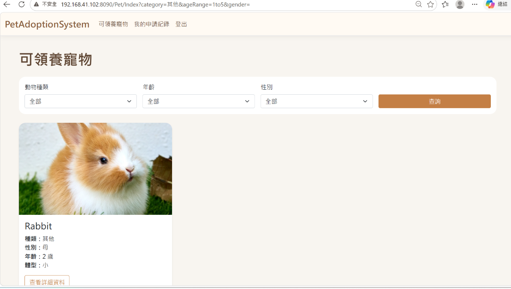
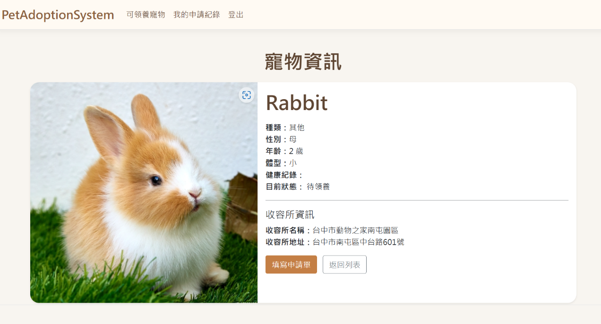
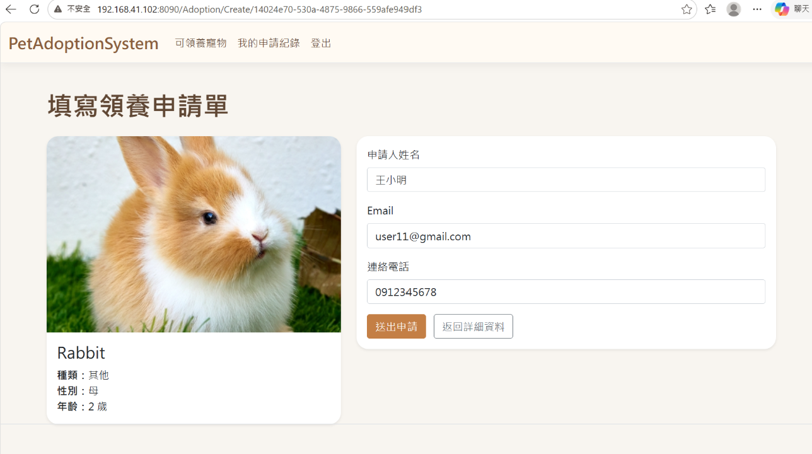
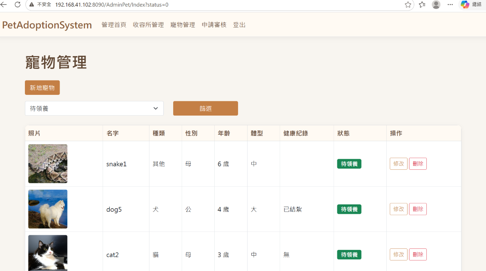
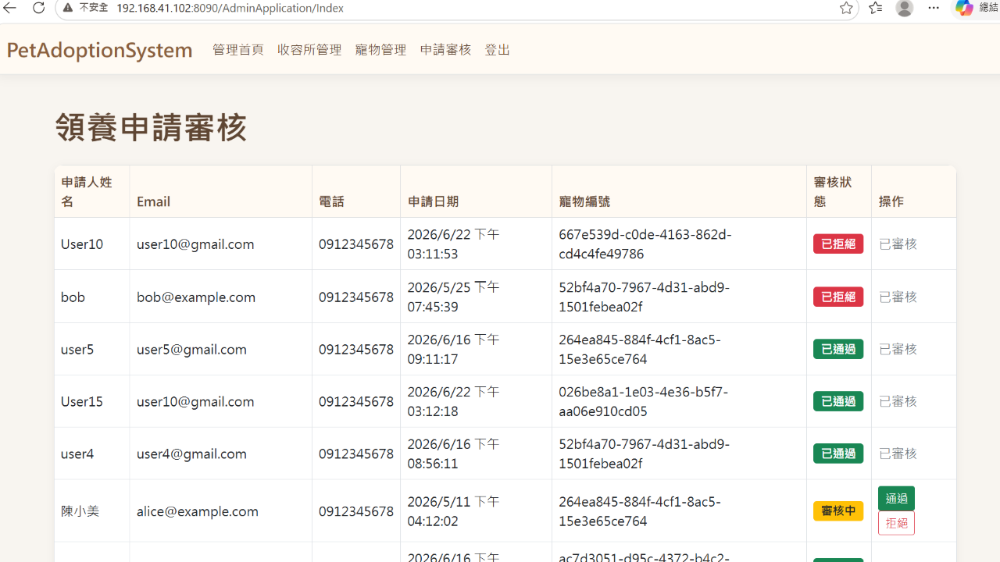

# 寵物領養與追蹤管理系統

本專案為資料庫課程的五人小組期末作品，延伸先前 Java 程式設計課程的寵物領養系統，透過 ASP.NET MVC 與 SQL Server，建立結合會員管理、寵物資料管理及領養申請審核功能的網頁系統。

系統分為一般會員與管理員兩種角色，提供不同的操作功能，並透過關聯式資料庫整合會員、寵物、收容所及領養申請等資料。

## 專案設計文件

本專案的設計文件包含系統功能規劃、個人參與內容、資料庫設計、功能展示及後續改善方向。

📄 [查看專案設計文件（PDF）](./寵物領養與追蹤管理系統.pdf)

## 專案功能

### 一般會員

- 會員註冊與登入
- 瀏覽可領養寵物
- 依動物種類、年齡及性別篩選寵物
- 查看寵物詳細資料
- 填寫並提交領養申請
- 查詢個人申請紀錄及審核狀態

### 系統管理員

- 收容所資料新增、修改及刪除
- 寵物資料新增、修改及刪除
- 寵物照片上傳與資料維護
- 查看會員領養申請
- 審核領養申請並更新狀態

## 使用技術

| 類別 | 技術／工具 |
|---|---|
| 開發環境 | Visual Studio |
| 網頁架構 | ASP.NET MVC |
| 程式語言 | C# |
| 資料庫 | SQL Server |
| 資料庫管理 | SQL Server Management Studio（SSMS） |
| 開發輔助 | ChatGPT、Gemini |

## 系統特色

**1. 會員與管理員權限區分**

依照使用者角色提供不同的操作功能，讓會員專注於寵物瀏覽與領養申請，管理員則負責資料維護及申請審核。

**2. 領養申請與寵物狀態連動**

會員提交領養申請後，系統會將寵物狀態更新為「申請中」，避免其他會員重複申請。申請通過後，寵物狀態則更新為「已領養」。

**3. 關聯式資料庫整合**

透過 User、Pet、Shelter 及 Adoption_Application 四張資料表，建立會員、寵物、收容所及領養申請之間的關聯。

## 系統畫面展示

本影片展示寵物管理系統的實際操作流程，包含主要功能及使用者介面。

[▶ 觀看系統操作 Demo（YouTube）](https://youtu.be/bn9xJI40oMg?si=ivI51-EAgqrqFPaq)

### 1. 寵物瀏覽
會員可瀏覽可領養的寵物，並依照動物種類、年齡及性別進行篩選。

### 2. 寵物詳細資料
顯示寵物的基本資訊、健康紀錄及所屬收容所，並提供領養申請入口。

### 3. 領養申請
會員可填寫領養申請表單，送出後由系統記錄申請資料及狀態。

### 4. 寵物資料管理
管理員可新增、修改及刪除寵物資料，並維護寵物照片與領養狀態。

### 5. 領養申請審核
管理員可查看會員提交的領養申請，並進行通過或拒絕的審核操作。

## 個人參與內容

本專案由五位組員共同完成，我主要負責：

- 系統功能與操作流程規劃
- 網頁介面設計及手繪草圖製作
- 部分程式實作與功能整合
- 運用 AI 工具輔助程式撰寫、除錯及功能測試

資料庫 ERD 繪製及期末報告製作與整理主要由其他組員負責。

## 專案說明

本儲存庫提供專案設計文件，包含系統功能介紹、資料庫設計及實際操作畫面。目前尚未提供完整原始程式碼及線上操作環境。
